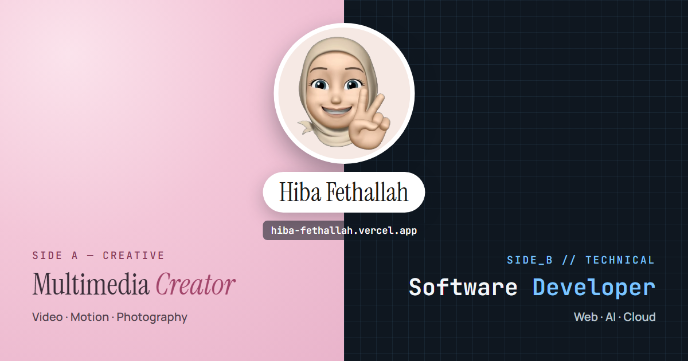

# Hiba Fethallah · Portfolio

**Live site: [hiba-fethallah.vercel.app](https://hiba-fethallah.vercel.app/)**



My personal portfolio, built around a two-sided ID badge on a lanyard: one side for **Multimedia**
(video editing, motion graphics, photography), the other for **IT** (web development, AI, cloud).
Flip the badge to switch between them.

## Highlights

- Interactive badge with flip animation and mouse tilt, written in plain JavaScript
- Two equal portfolios on one page: video and photo work, and software projects
- Featured projects: EDMS (multi-tenant document management with OCR and Elasticsearch) and SwiftDeliver (transport and delivery platform)
- Downloadable CV, responsive layout, Open Graph preview image
- No framework and no build step: fast to load and easy to host

## Tech

HTML · CSS (custom properties for theming) · vanilla JavaScript · deployed on Vercel

## Structure

```
index.html        page markup
css/style.css     all styles; side colours are CSS variables at the top
js/main.js        badge flip, tilt and gallery behaviour
assets/           images, video previews, icons and CV
```

## Run locally

Open `index.html` in a browser, or use the VS Code Live Server extension.
